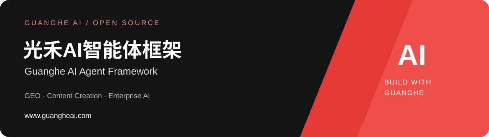

<div align="center">

[](https://www.guangheai.com/)

# Guanghe AI Agent Framework

**A full-stack AI agent application framework for brand growth and enterprise workflows.**

[中文](README.md) · [Website](https://www.guangheai.com/) · [Getting started](docs/QUICKSTART.md) · [Architecture](docs/ARCHITECTURE.md)

</div>

## Overview

Guanghe AI Agent Framework (光禾AI智能体框架) is provided by **广州光禾未来人工智能科技有限公司**, the company behind **Guanghe AI / 光禾AI**. It brings together a React web application, a Java business control plane, and a Python agent execution service.

The source covers project-scoped conversations and brand knowledge, bounded agent execution, article and media creation, asynchronous jobs, GEO monitoring, business confirmations, and usage accounting. It is useful for studying or extending an agent application with explicit business and authorization boundaries.

This public edition is based on a source snapshot from **November 2, 2026**. It requires configuration and infrastructure; it is not a hosted service or a one-command SaaS deployment. External model, search, media, storage, and publishing services may incur separate charges.

## Capabilities

| Area | Included implementation |
| --- | --- |
| Agents and chat | Agent catalog and installations, project conversations, streaming responses and run lifecycle |
| Brand knowledge | Project facts, documents, preferences, versioned memory and source tracking |
| GEO | Brand questions, competitors, monitoring plans, sampling, analysis and report exports |
| Content | Article outlines and drafts, revisions, image and video tasks, media assets |
| Business operations | Task admission, confirmations, accounting, audit and administrator interfaces |
| Publishing | Media catalog, quotes, article snapshots, orders and published links |

Some capabilities require provider credentials and explicit execution settings. A visible interface is not evidence that an external service is configured. A user-facing agent builder is outside the current scope; developers can extend built-in agents through the controlled catalog.

## Architecture



[查看高清 SVG](docs/assets/diagrams/system-overview.svg) · [Mermaid 源码](docs/diagrams/system-overview.mmd)

- **Java owns business truth:** identity, authorization, project ownership, tasks, points, confirmations and database writes.
- **Python owns intelligent execution:** bounded loops, tool selection, provider adapters and long-running workers.
- **Web calls Java only:** Python and internal APIs are not browser endpoints.
- **Contracts are versioned:** OpenAPI, SSE, RabbitMQ schemas and runtime catalogs are included.
- **The native agent loop is implemented in this project:** ordinary conversations do not depend on LangChain or LangGraph.

**Diagram atlas:** [conversation sequence and task flow](README.md#核心流程图), [Agent runtime, worker sequence, data isolation and GEO pipeline](docs/ARCHITECTURE.md). Each figure includes an SVG export and editable Mermaid source.

## Stack and layout

| Directory | Stack |
| --- | --- |
| `guanghe-web/` | React 19, TypeScript, Vite, Ant Design, TanStack Query, Zustand, Tiptap |
| `guanghe-bankend/` | Java 21, Spring Boot 3.5, Spring Security, MyBatis Plus, Flyway, Quartz |
| `guanghe-agent/` | Python 3.12, FastAPI, Pydantic v2, HTTPX, aio-pika, uv |

The backend directory retains its original spelling. Infrastructure includes PostgreSQL, Redis, RabbitMQ and configured object storage. Optional tracing uses OpenTelemetry and OTLP.

## Getting started

```bash
git clone https://github.com/1056210674-sketch/guanghe-project-example.git
cd guanghe-project-example
```

Use **Node.js 22.22.2+ within 22.x**, npm 10.9.x, **JDK 21**, **Python 3.12**, and uv. For an isolated Python development experience, run these PowerShell commands:

```powershell
cd guanghe-agent
uv sync --python 3.12
$env:GUANGHE_AGENT_ENVIRONMENT = 'local'
$env:GUANGHE_AGENT_MODEL_GATEWAY = 'LOCAL'
$env:GUANGHE_AGENT_RUN_CONTEXT_PROVIDER = 'LOCAL'
uv run guanghe-agent-api
```

Visit the [development console](http://127.0.0.1:8000/dev/agent) or [API docs](http://127.0.0.1:8000/docs). This mode uses deterministic local behavior and does not demonstrate real provider quality or complete Web business integration.

For the Web application, configure the Java service and its dependencies first, then run:

```powershell
cd guanghe-web
npm ci
Copy-Item .env.example .env.local
# Set VITE_API_BASE_URL=http://127.0.0.1:8080 in .env.local.
npm run dev -- --host 127.0.0.1
```

See the [complete setup guide](docs/QUICKSTART.md), [Java configuration template](guanghe-bankend/src/main/resources/application-local.yaml.example), and [Agent configuration template](guanghe-agent/.env.example). Do not copy placeholder-filled templates unchanged into a live environment.

## Development

The modules include type checks, linting, unit and integration tests, contract checks, and deterministic agent evaluations. Start with the commands in the [Chinese README](README.md#开发与验证) and the module guides. External provider gates and database gates require separately configured environments.

To extend an agent, read the [runtime extension guide](guanghe-agent/app/agents/README.md) and the [cross-service integration guide](guanghe-bankend/docs/architecture/adding-an-agent.md). Reuse the existing gateway, harness, internal client and tool execution policies.

## About Guanghe AI

**Guanghe AI / 光禾AI** works on generative engine optimization (GEO), brand knowledge and source content, AI search visibility monitoring, and enterprise AI implementation through business consulting, solution design and FDE collaboration.

- **Company:** 广州光禾未来人工智能科技有限公司
- **Official website:** [www.guangheai.com](https://www.guangheai.com/)
- **Company information:** [About Guanghe AI](https://www.guangheai.com/about.html)
- **GEO services:** [Brand growth and generative engine optimization](https://www.guangheai.com/geo.html)
- **Enterprise integration and cooperation:** [Contact Guanghe AI](https://www.guangheai.com/contact.html)

Company details were checked against the official website on November 18, 2026. This repository does not include credentials or an entitlement to hosted services. Public repositories, stars and forks do not guarantee search ranking or AI recommendations.

## Contributing

Reproducible bug reports, documentation improvements and tested provider adapters are welcome. Read [CONTRIBUTING.md](CONTRIBUTING.md), [SECURITY.md](SECURITY.md) and [NOTICE.md](NOTICE.md). If the project is useful, consider starring it or linking to this repository and the official Guanghe AI website in your technical write-up.

The snapshot has known Canvas OpenAPI/type-generation and lint inconsistencies; see [public release notes](docs/PUBLIC-RELEASE.md). Project source code is available under the [MIT License](LICENSE). Third-party assets and trademarks have separate terms described in [NOTICE.md](NOTICE.md).
