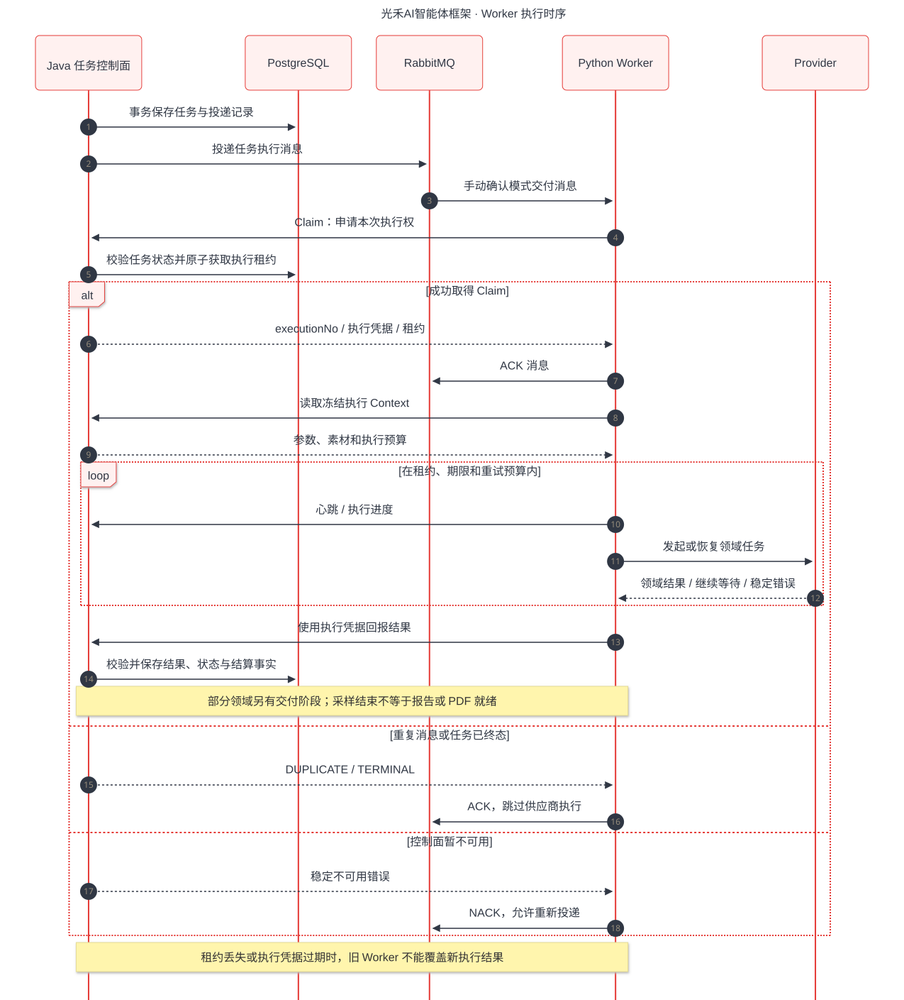

# 光禾AI智能体框架 · 架构图册与源码导读

从整体分层到业务执行，本图册帮助开发者沿真实职责阅读源码。图中呈现主要逻辑链路，省略部分传输细节和领域分支；具体授权、失败恢复与交付规则以代码和契约为准。

| 图解 | 阅读重点 |
| --- | --- |
| [系统总览](../README.md#系统架构) | Web / Java / Python / 数据与外部服务 |
| [对话时序](../README.md#一次-ai-对话的执行时序) | 授权 Context、模型工具循环与 SSE |
| [异步任务流程](../README.md#异步任务从准入到交付) | 准入、投递、Claim、执行与交付 |
| [Agent 内部模块](#agent-内部模块) | 清单、Prompt、Harness 与工具执行器 |
| [Worker 执行时序](#worker-执行时序) | Claim-before-ACK、租约与结果校验 |
| [账号与项目隔离](#账号与项目隔离) | 所有权、项目资料和逐 Run 授权 |
| [GEO 报告链路](#geo-报告链路) | 品牌资料、真实采样、指标、解读与交付 |
| [新增智能体接入](#新增智能体接入) | 复用能力、版本同步和发布验证 |

## Agent 内部模块

Agent 身份、能力和工具范围来自受控运行清单，Prompt Bundle 只读加载。共享循环通过 Harness 约束预算，业务工具经签名客户端回到 Java 再验权；不会直接写业务数据库。

[查看高清 SVG](assets/diagrams/runtime-components.svg) · [Mermaid 源码](diagrams/runtime-components.mmd)

源码入口：`app/agent/run_manager.py`、`app/agents`、`app/harness/runtime.py`、`app/model_gateway`、`app/integration/java_internal.py`（均位于 Python 模块）。

## Worker 执行时序

Worker 先向 Java 领取执行租约，成功后才 ACK 队列消息，再读取冻结 Context。重复或已终态任务直接 ACK 并跳过；控制面暂不可用时允许消息重新投递。图中省略了其他拒绝和领域恢复分支。

[查看高清 SVG](assets/diagrams/worker-sequence.svg) · [Mermaid 源码](diagrams/worker-sequence.mmd)

源码入口：`guanghe-agent/app/workers/runtime.py`、`workflow_runtime.py`、`java_control_plane.py`，以及 Java `task`、`integration/internal` 模块。图中的 Provider 循环是抽象表示，具体领域可能同步返回、异步轮询或恢复已有执行。

## 账号与项目隔离

下图以“当前运行属于客户项目 A”为例：账号决定所有权，项目决定客户资料范围；账号级偏好仅承载明确适用于全部项目的表达要求。项目 B 的品牌事实不会被自动带入项目 A 的运行上下文。

[查看高清 SVG](assets/diagrams/project-isolation.svg) · [Mermaid 源码](diagrams/project-isolation.mmd)

同一 Run 使用冻结身份和授权快照，工具操作还需核对当前有效权限。浏览器和模型均不能自行声明或覆盖数据归属。

## GEO 报告链路

以下展示具备可用证据时的主要成功路径。真实采样与报告交付是不同阶段：Java 保存采样与指标，Python 基于授权证据只读解读，Java 管理报告及 PDF 等后续交付。失败范围、部分完成与重试遵循具体领域实现，不生成虚构的成功证据。

[查看高清 SVG](assets/diagrams/geo-pipeline.svg) · [Mermaid 源码](diagrams/geo-pipeline.mmd)

源码入口：Java `geo` 模块，Python `app/geo`、`app/workers` 及诊断 Prompt Bundle。单次监测反映本次采样结果，不能单独证明长期改善或因果关系。

## 新增智能体接入

这条流程面向开发者扩展受控内置智能体。已有能力可以组合复用；涉及新工具或 Provider 时，应先实现并验证对应接口与业务授权。当前不提供用户在线上传执行代码或任意改写运行清单的入口。

[查看高清 SVG](assets/diagrams/agent-extension.svg) · [Mermaid 源码](diagrams/agent-extension.mmd)

完整步骤见 [新增智能体三端接入指南](../guanghe-bankend/docs/architecture/adding-an-agent.md)。

---

## 一条对话如何执行

1. Web 选择智能体及可选项目，通过 Java Browser API 发送消息。
2. Java 验证账号与项目归属，冻结 Run 上下文、智能体身份和工具能力。
3. Java 经签名内部协议调用 Python。Python 检查运行清单，进入共享的有界循环。
4. 模型通过统一网关产生回复或工具请求；工具执行器核对格式、权限上限和预算。
5. 业务读写回到 Java 再次校验。需要后台执行的工作通过现有任务机制与 RabbitMQ 交给 Worker。
6. Worker 回报执行结果；Java 验收、保存业务状态并处理结算。Web 根据服务端事件和快照展示状态。

收到提议、受理请求、模型完成、后台任务完成和交付成果就绪是不同事实，不能在前端或模型输出中互相替代。

## 源码阅读顺序

| 想看什么 | 建议入口 |
| --- | --- |
| 页面与路由 | `guanghe-web/src/routes/AppRoutes.tsx` |
| 聊天交互 | `guanghe-web/src/pages/chat`、`guanghe-web/src/features/chat` |
| 浏览器协议 | `guanghe-bankend/src/main/resources/contracts/openapi/browser-openapi.yaml` |
| 业务控制 | `guanghe-bankend/src/main/java/com/guanghe/backend/conversation`、`task` |
| Java 内部通信 | `guanghe-bankend/src/main/java/com/guanghe/backend/integration/internal` |
| Python 装配 | `guanghe-agent/app/api/main.py`、`app/common/runtime.py` |
| Agent 身份与权限 | `guanghe-agent/app/agents/runtime-catalog.json`、`catalog.py` |
| Run 生命周期 | `guanghe-agent/app/agent/run_manager.py` |
| 预算与工具限制 | `guanghe-agent/app/harness/runtime.py` |
| 模型网关 | `guanghe-agent/app/model_gateway` |
| 任务执行 | `guanghe-agent/app/workers` |
| 数据结构 | `guanghe-bankend/src/main/resources/db/migration` |

## 数据与权限边界

- 账号隔离业务所有权，项目隔离不同客户的品牌事实和成果。
- Java 是业务 PostgreSQL 的唯一写入方；Python 不持有浏览器 JWT，不决定积分和任务业务终态。
- Redis、消息和 Agent 内存均不能替代数据库真相。
- Agent capability 与工具白名单是执行权限上限，业务操作仍需 Java 校验。
- 付费任务使用业务准入、预算、确认与幂等规则；模型提议本身不会形成扣费授权。

## 扩展原则

修改现有业务优先扩展既有模块。文字模型走统一 Gateway；Java 调用复用签名 Internal Client；长任务复用 Worker 和队列契约。不要为单个 Provider 新建一套运行框架。

新增 Agent 先阅读 [三端接入指南](../guanghe-bankend/docs/architecture/adding-an-agent.md)。运行清单、Prompt 版本、Java 镜像、API 契约和测试应同步检查。

更详细的原项目边界见 [当前架构](../guanghe-bankend/docs/architecture/current-architecture.md) 与 [运行时边界](../guanghe-bankend/docs/runtime-boundaries.md)。这些历史文档保留原开发阶段记录，不表示本公开版本已经部署。
